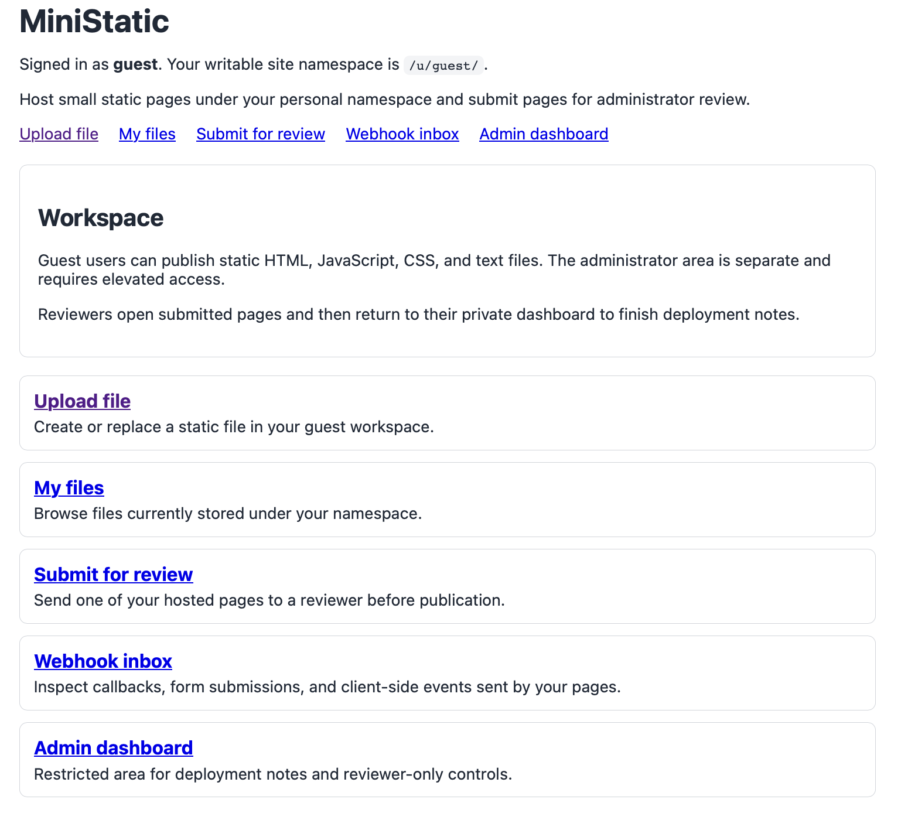
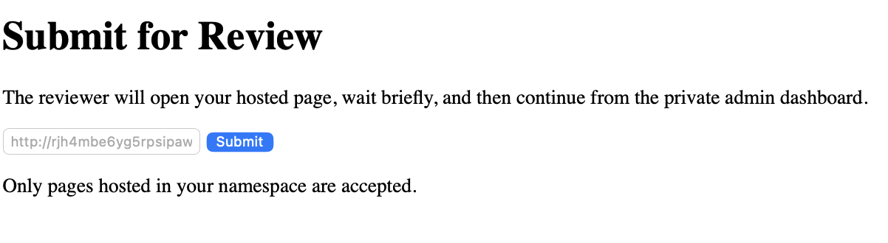

This was my second time participating in a CTF. I recently joined the team SeaWhisper0, only three of us worked together, and I'd personally say we crushed it landing 96th place. Not bad for just starting out.

## The start

I actually solved this one pretty quickly. I woke up late, completely forgetting I had a CTF that day. I opened it up and went straight to web, since that's my strongest skill set.

The challenge was called **Scope Drift**, hosted on a platform called **MiniStatic**: a small file-hosting service where you can upload static HTML pages under your personal namespace and submit them for administrator review.

## The clue I missed

The review page had the most useful clue in the challenge, and I read right past it the first time.

> The reviewer will open your hosted page, wait briefly, and then continue from the private admin dashboard.

I’d been thinking about what my uploaded page could see while the bot was looking at it. I checked for cookies and came up empty. Reading that line again gave me a better question: what would the browser carry with it when the reviewer left my page?

## What the scope was

The browser feature behind the challenge was a service worker. A service worker belongs to an origin and has a URL scope within it. Once registered, it can outlive the page that registered it and handle requests from pages it controls.

MiniStatic gave each guest a personal directory. From the upload screen, that directory looked like a boundary between my content and the administrator’s. Both areas, though, lived on the same origin. The review depended on browser state staying inside the guest area even as the reviewer moved on to private work. That was the assumption the challenge broke.

## What I took away

If I were building MiniStatic, I’d serve guest uploads from a separate origin and open each submission in a disposable browser profile. The administrator could then return to the dashboard in a separate profile that had never loaded guest content.

The part I’ll remember is that I had already read the clue before I understood it. I was looking at the upload page. The challenge was asking me to follow the reviewer through the *next* page, too.
